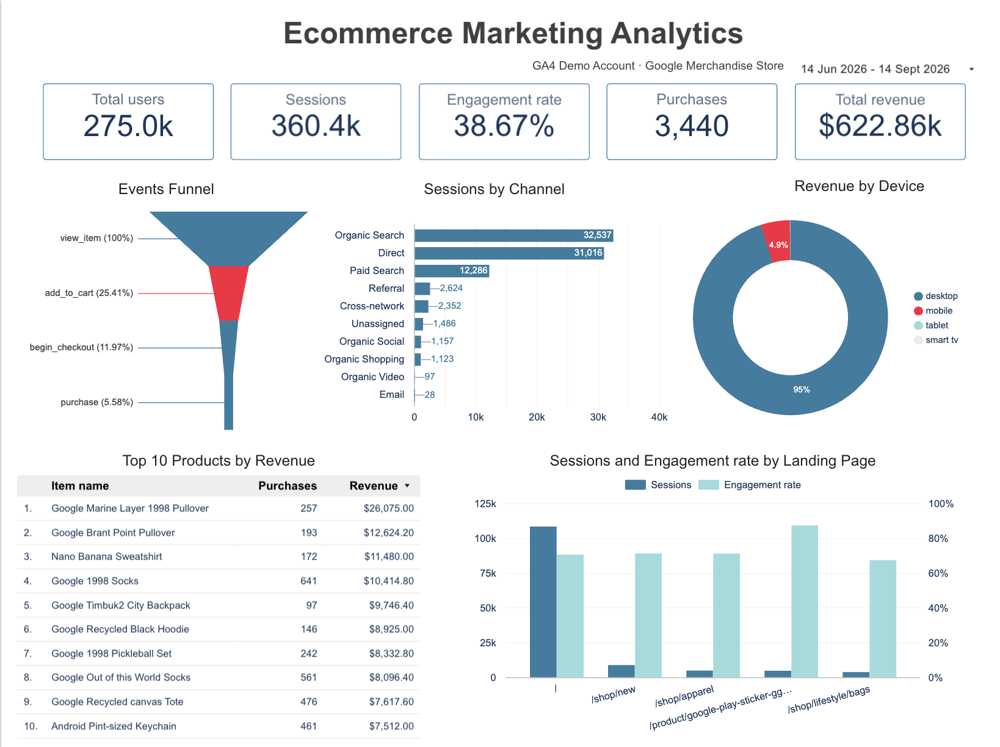
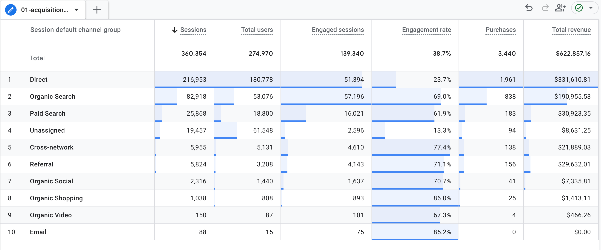
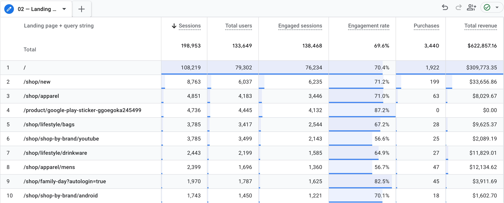
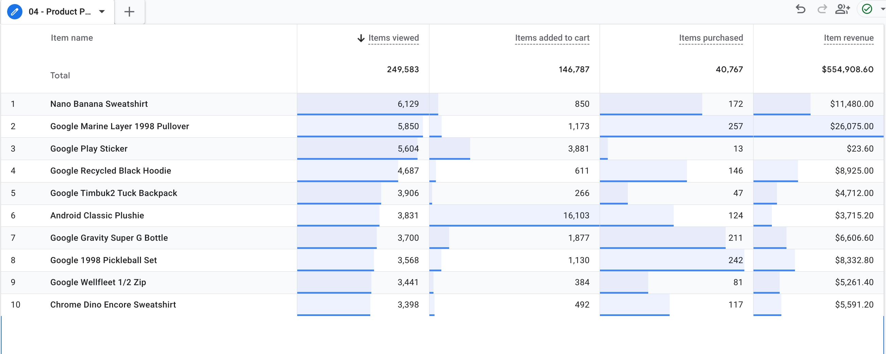
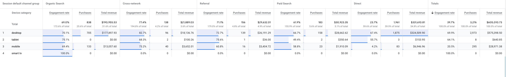
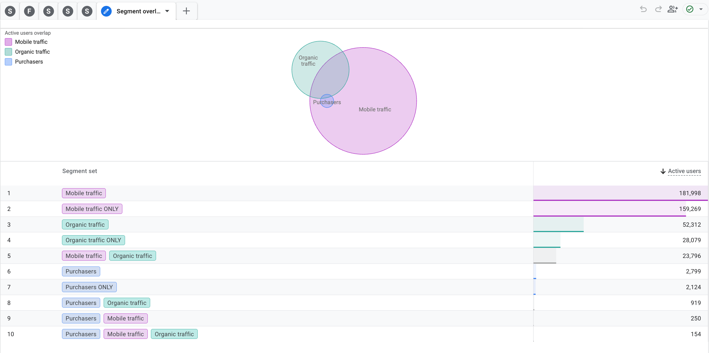

# Ecommerce Marketing Analytics: GA4 Demo Account

Analysis of e-commerce and marketing performance in Google Analytics 4 (GA4). The project uses Google's public GA4 Demo Account (Google Merchandise Store). It includes a Looker Studio dashboard and a written analysis with findings and recommendations.

**Live dashboard:** [Open in Data Studio](https://datastudio.google.com/reporting/ea9eb225-6c7c-4e2b-a57f-5997df9bf643)
**Period analyzed:** 14 Jun 2026 – 14 Sep 2026

---

## Business questions

1. Which acquisition channels and landing pages bring valuable traffic, and not only high volume?
2. Where do users drop off in the e-commerce funnel, and is this different by device and channel?
3. Which products and user segments need a closer look?

---

## Data and tools

- **Data source:** GA4 Demo Account (Google Merch Store). This is public demo data, not a real client.
- **Analysis:** GA4 standard reports and Explorations (funnel exploration, segment overlap)
- **Dashboard:** Data Studio (Looker Studio)
- **Skills demonstrated:** GA4, funnel analysis, segmentation, dashboard design, data validation

### Metric definitions

| Metric | Meaning |
|---|---|
| Engagement rate | Share of sessions that were engaged sessions (GA4 definition) |
| Revenue per session | Total revenue ÷ sessions (calculated) |
| Funnel steps | `view_item` → `add_to_cart` → `begin_checkout` → `purchase` |
| Step conversion | Share of users who move from one funnel step to the next |

---

## Approach

1. **Acquisition:** compared channels by sessions, engagement rate, revenue and revenue per session.
2. **Landing pages:** compared entry pages. Technical and unassigned landing-page records were excluded, because they had extremely low engagement and no purchases.
3. **Funnel:** measured drop-off between funnel steps, then split it by device and channel.
4. **Products:** compared item views, add-to-cart events, purchases and revenue.
5. **Devices:** compared purchases and revenue by device category.
6. **Segments:** checked the overlap between Purchasers, Organic traffic and Mobile traffic.
7. **Data quality:** checked unusual values before drawing conclusions.

---

## Key findings

### 1. Acquisition performance differs by channel

| Channel | Sessions | Revenue | Revenue per session* |
|---|---|---|---|
| Direct | 216,953 | $331.6K | ≈ $1.53 |
| Organic Search | 82,918 | $191.0K | ≈ $2.30 |
| Referral | 5,824 | $29.6K | ≈ $5.08 |

*Calculated as revenue ÷ sessions.

- Direct has the largest volume and revenue, but its engagement rate is low (**23.7%**).
- Organic Search has fewer sessions, but a much higher engagement rate (**69.0%**).
- Referral is small, but earns the most per session. Lower-volume sources may deserve a closer look.

### 2. Landing page performance differs significantly

- The homepage (`/`) is the main entry point: **108,219 sessions, 70.4% engagement, 1,922 purchases, $309.8K revenue** (≈ $2.86 per session).
- Some smaller pages earn more per session: `/shop/apparel/mens` (≈ **$5.06**), `/shop/lifestyle/drinkware` (≈ **$4.84**) and `/shop/new` (≈ **$3.84**).
- The Google Play Sticker product page had **4,736 sessions and 87.2% engagement, but no purchases**. High engagement does not always mean purchase.

### 3. The largest funnel drop-off is between product view and add to cart

| Step | Users | Step conversion* |
|---|---|---|
| View item | 54,155 | – |
| Add to cart | 13,336 | 24.6% |
| Begin checkout | 6,246 | 46.8% |
| Purchase | 2,978 | 47.7% |

*Calculated from the user counts.

Desktop and mobile behave differently:

| Metric | Desktop | Mobile |
|---|---|---|
| View item → add to cart | 29.0% | 18.5% |
| View item → purchase | 8.4% | 1.3% |
| Begin checkout → purchase | ≈ 54.9% | ≈ 21.6% |

The largest device gap is at the **begin checkout → purchase** step.

### 4. Funnel progression differs by channel

- **Direct:** 10.6% of product viewers reach purchase.
- **Organic Search:** the most product viewers (20,791), but only 2.7% reach purchase.
- **Paid Search:** only 19.3% move from add to cart to begin checkout.

Acquisition source and device should be evaluated together.

### 5. Product performance varies

- **Google Marine Layer 1998 Pullover** has the highest item revenue among the displayed products: **$26.0K** and 257 purchases.
- **Nano Banana Sweatshirt:** 172 purchases from 6,129 item views.
- **Android Classic Plushie** has more add-to-cart events than item views (16,103 vs 3,831). This needs validation before it is used for conversion analysis (see Limitations).

### 6. Desktop generates most e-commerce results

| Device | Purchases | Revenue |
|---|---|---|
| Desktop | 2,973 | $575.4K |
| Mobile | 295 | $29.0K |
| Tablet | 8 | $641 |

Desktop accounts for about **90.8% of purchases** and **95.1% of revenue** in this analysis.

### 7. Segment overlap shows a small but relevant mobile-organic group

- **2,799** users are in the Purchasers segment.
- **919** of them also belong to Organic traffic (**32.8%**).
- **250** also belong to Mobile traffic (**8.9%**).
- **154** belong to Mobile + Organic + Purchasers (**5.5%** of purchasers).

The overlap does not show whether this group converts better or worse. It only identifies a segment to investigate.

---

## Recommendations

These are areas to investigate, not proven causes. GA4 data alone cannot prove the reason behind a pattern.

1. **Investigate the mobile checkout journey.** The gap between desktop and mobile is largest at begin checkout → purchase. Possible areas: checkout usability, mobile page speed, form and payment experience, device-specific errors, abandonment by checkout step.
2. **Investigate high-traffic, low-conversion landing pages.** For example, the Google Play Sticker page (4,736 sessions, no purchases). Check whether traffic intent matches the product, whether the page is meant to drive direct purchases, and whether there are tracking limitations.
3. **Evaluate acquisition sources together with downstream conversion.** Compare sources by sessions, engagement, add-to-cart rate, checkout progression, purchase rate and revenue per session.
4. **Review paid traffic and landing page alignment.** Paid Search shows the weakest add-to-cart → begin checkout step (19.3%). Check which campaigns and landing pages drive this, including whether paid traffic reaches low-converting pages.
5. **Validate product-level event tracking.** Check the Android Classic Plushie events before using product-level conversion metrics.

---

## Limitations

- **Demo data.** This is a public demo property, not a real business. I could not check the website or checkout process directly.
- **No advertising cost data.** The ROI of Paid Search cannot be evaluated.
- **Different units and filters.** The dashboard funnel counts **events** (add to cart: 25.41% of views), while the GA4 Exploration counts **users** (24.6%). Dashboard KPIs cover all channels (3,440 purchases, $622.86K revenue), while the device and product findings use selected acquisition channels (3,276 purchases). Purchase numbers are also reported as users and as events, so they do not match exactly.
- **Direct traffic** may include sessions that GA4 could not attribute to a source.
- **Small samples.** Revenue per session for low-traffic landing pages can change a lot with a few purchases.
- **Unvalidated product data.** The Android Classic Plushie add-to-cart anomaly is not explained. A possible reason is that products can be added to the cart from list pages without a product view, but this is a hypothesis.
- **Observational analysis.** The findings show patterns, not causes.

---

## Author

**Olha** — Data Analyst
